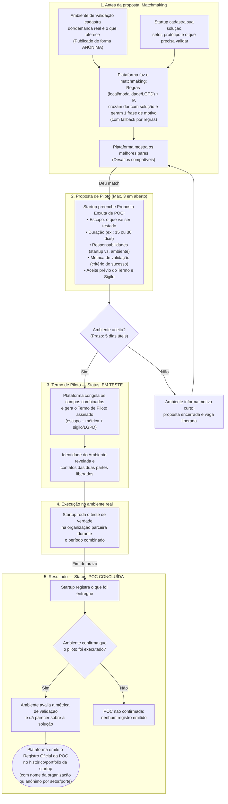

# Azreal (POC-Match): Documento Oficial de Produto e Requisitos (Versão Matchmaking de Validação e POC)

**Faculdade Senac Pernambuco — Análise e Desenvolvimento de Sistemas (2026.2)**  
**Equipe Grupo 2 (Azreal):** Ágata Oliveira, Alanna Santos, Arthur Cunha, César Silva e Giselly Lima.

---

## 1. Visão Geral e Mudança de Escopo

O **Azreal** é uma plataforma de matchmaking de validação que conecta startups *early stage* a empresas, instituições e órgãos parceiros (**Ambientes de Validação**) com demandas operacionais reais para realizar **Provas de Conceito (POCs)** estruturadas e gerar evidências verificáveis de tração.

### 1.1 Justificativa da evolução do escopo (Evidências da Pesquisa)
1. **Dor central relatada pelas startups entrevistadas (*Nook* e *Rede Leito*):** ambas apontaram literalmente a **validação** — e especificamente a **Prova de Conceito (POC)** aplicada em um ambiente real — como a principal dificuldade para detectar e conquistar novos clientes, definindo a POC como *"um documento que atesta que já passou por um processo de validação; para editais e programas ela serve como tracionamento, um documento essencial"*.
2. **Como tentam resolver hoje (comportamento atual):** buscam validação de forma improvisada e fria (*direct* no Instagram, e-mails, formulários, abordagem em eventos e grupos de WhatsApp).
3. **Convergência com articuladores e mentores entrevistados (*Edil* e *Prof. Genésio*):** o *matching comercial* foi apontado como o mais necessitado pelas startups hoje, e o matchmaking de validação via inovação aberta (conectando a startup a uma demanda real e prioritária de uma empresa ou secretaria de governo) foi destacado como o passo determinante antes de editais de escala ou investimento.
4. **Diferenciação clara em relação aos demais projetos da turma:**
   - **Não replica o *Percentangel*:** não conecta startups a investidores-anjo nem utiliza sistema de pontuação ponderada com soma 100% ou *scorecard*.
   - **Não replica o *DaMatch*:** não tem como proposta principal o matchmaking startup–mentor nem o registro de atas de encontros de mentoria.
   - **Identidade própria:** conecta **Startup ↔ Ambiente de Validação (Desafio Real)**, formaliza um **Termo de Piloto** com proteção de identidade/sigilo e emite um **Registro Oficial de POC** confirmado pelo parceiro após o teste real.

---

## 2. Público-Alvo e Perfis de Usuário

| Perfil | Papel na Plataforma |
| :--- | :--- |
| **Startup (*Lado A*)** | Startups *early stage* de base tecnológica e economia criativa (escopo inicial: Recife/PE), sem receita recorrente relevante, que possuem protótipo ou MVP e precisam testá-lo em ambiente real para validar a solução, conquistar clientes ou comprovar tração em editais. |
| **Ambiente de Validação (*Lado B*)** | Pequenas e médias empresas, instituições de ensino/saúde, comunidades e órgãos públicos locais que possuem dores operacionais reais e disponibilizam um ambiente controlado para testar soluções em formato de piloto. |
| **Incubadoras / Programas (*Catálogo complementar*)** | Mantidas como catálogo consultivo pela administração (com foco, critérios de entrada, modalidade e link externo) para apoiar startups em fase inicial que ainda buscam incubação. |
| **Administrador** | Contas criadas de forma privada pela equipe para curadoria do vocabulário de temas/setores, gestão do catálogo complementar, regras da plataforma e moderação de contas. |

---

## 3. Proposta de Valor e Fluxo Principal do MVP (com os Ajustes Finos)

### 3.1 Proposta de Valor
* **Para Startups *early stage*:** substituir a prospecção fria e informal por um canal estruturado de matchmaking com demandas reais de organizações parceiras, transformando planos no papel em **Provas de Conceito (POCs) executadas e atestadas**.
* **Para Ambientes de Validação:** experimentar soluções inovadoras alinhadas às suas dores operacionais prioritárias sem custo inicial de contratação, com **identidade preservada (desafio anônimo)** até o aceite do piloto e proteção de sigilo/LGPD.

### 3.2 Fluxo Principal do MVP (Passo a Passo)

1. **Cadastro e Perfil de Capacidade / Ambiente (com consentimento LGPD):**
   - A **Startup** cadastra sua solução, setor/temas de atuação, estágio atual do protótipo, localidade e o que precisa validar em ambiente real.
   - O **Ambiente de Validação (Organização Parceira)** cadastra seu perfil e publica **Desafios de Validação** descrevendo a dor operacional, a prioridade, o ambiente disponível para teste (ex.: nº de usuários/setor), a modalidade (presencial ou remota) e a duração máxima do piloto.

2. **Publicação anônima do desafio (Proteção em camadas):**
   - O desafio é exibido às startups apenas como problema — com setor, público de teste, modalidade e restrições —, **sem o nome da organização**. A identidade do Ambiente de Validação só é revelada após a formalização do Termo de Piloto pelos dois lados (Passo 5).

3. **Matchmaking de Demanda ↔ Solução (Apoiado por IA + Regras de Restrição e Fallback):**
   - O sistema primeiro filtra critérios objetivos (localidade, modalidade presencial ou remota, requisitos de privacidade/LGPD).
   - Em seguida, a IA compara o texto de cada desafio com o perfil da startup, ordena os desafios do mais ao menos compatível (sem usar pontuação percentual de 0 a 100%) e **explica em uma frase curta o motivo de cada sugestão**.
   - *Contingência (Fallback por regras):* caso a API externa de IA falhe ou fique indisponível, o sistema ordena automaticamente os desafios por regras objetivas (setor, temas do vocabulário e modalidade/região) e gera uma frase justificativa padronizada por template.

4. **Proposta de POC (Solicitação Estruturada com Aceite Prévio):**
   - A startup visualiza os desafios recomendados e envia uma **Proposta Enxuta de POC** contendo:
     - **Objetivo e Escopo do teste:** o que será entregue e testado no piloto;
     - **Duração sugerida:** ex.: 15 ou 30 dias (dentro do limite do desafio);
     - **Responsabilidades:** o que a startup entrega vs. o que o ambiente disponibiliza;
     - **Métrica de validação:** indicador objetivo que será avaliado ao final;
     - **Aceite prévio do Termo de Piloto e Cláusula de Sigilo:** assinado pela startup no ato do envio.
   - O limite é de até **3 propostas simultâneas em aberto** por startup (para desafios diferentes).

5. **Aceite e Termo de Piloto (`Status: EM TESTE`):**
   - O Ambiente de Validação analisa a proposta na sua fila (prazo de resposta de até **5 dias úteis** pelo calendário estadual de Pernambuco).
   - **Se aceitar:** como a startup já assinou preventivamente no envio da proposta (Passo 4), o aceite do Ambiente congela imediatamente os campos combinados e gera o **Termo de Piloto** assinado pelas duas partes (com escopo, duração, responsabilidades, métrica de validação e cláusula de sigilo/LGPD). Só então a identidade do Ambiente de Validação é revelada e os canais de contato são liberados.
   - **Se recusar:** o ambiente informa um motivo curto (ex.: fora de prioridade, prazo incompatível), a proposta é encerrada e a vaga no limite de 3 propostas da startup é liberada automaticamente, retornando o usuário à lista de desafios compatíveis.

6. **Execução do piloto em ambiente real:**
   - A startup executa o teste de verdade no ambiente do parceiro, dentro do escopo e da duração definidos no Termo de Piloto, e registra na plataforma o resumo do que foi entregue ao final do prazo.

7. **Conclusão e Registro de POC (`Status: POC CONCLUÍDA`):**
   - Ao fim do piloto, o Ambiente de Validação confirma na plataforma se o teste foi executado:
     - **Se o piloto foi executado:** o Ambiente avalia o resultado com base na métrica de validação definida no Termo (*Atendeu totalmente*, *Atendeu parcialmente* ou *Não atingiu a métrica*) e registra seu parecer. A plataforma emite no histórico/portfólio da startup um **Registro Oficial de POC** confirmado pelo parceiro (que serve como evidência verificável de tração para editais e clientes). O registro pode ser exibido com o **nome da organização** ou de **forma anônima qualificada** (apenas setor e porte), conforme autorização do ambiente.
     - **Se o piloto não ocorreu / foi abandonado:** o teste é encerrado como *POC não confirmada*, sem emissão de registro no portfólio.

### 3.3 Diagrama Oficial do Fluxo

---

## 4. Requisitos Funcionais Atualizados (Azreal POC-Match)

| ID | Requisito Funcional | Categoria |
| :--- | :--- | :--- |
| **RF01** | A **Startup** cria seu perfil com nome, descrição da solução, setor/área de atuação, data de fundação, estágio do protótipo (protótipo inicial, MVP funcional ou em teste), integrantes, localidade (estado e município via IBGE) e o que precisa validar em ambiente real. Conclui o cadastro apenas após aceitar os termos de uso e tratamento de dados (LGPD). | Acesso e Cadastro |
| **RF02** | A **Startup** seleciona temas do vocabulário padronizado (RF08) e modalidades de teste suportadas (presencial, remoto ou híbrido). | Acesso e Cadastro |
| **RF03** | O **Ambiente de Validação** cria seu perfil organizacional com razão/nome fantasia, setor, porte, localidade (IBGE), canais de contato (e-mail obrigatório, telefone/LinkedIn opcionais) e aceita os termos de uso e LGPD. | Acesso e Cadastro |
| **RF04** | O sistema autentica usuários e restringe o acesso por perfil: `STARTUP`, `AMBIENTE_VALIDACAO` e `ADMIN`. Contas de administrador são criadas de forma privada pela equipe. | Acesso e Cadastro |
| **RF05** | O **Ambiente de Validação** publica, edita e inativa **Desafios de Validação**, informando: título do problema, descrição da dor operacional, prioridade, setor/temas (RF08), ambiente disponível para teste (ex.: nº de usuários/setor), modalidade (presencial ou remota), duração máxima do piloto e restrições de dados/LGPD. | Desafios e Catálogos |
| **RF06** | Os **Desafios de Validação** ativos são exibidos de forma **anônima** para as startups (mostrando apenas o problema, setor, porte da organização, modalidade, ambiente de teste e restrições, ocultando o nome e os contatos da organização parceira até o aceite no RF15). | Privacidade em Camadas |
| **RF07** | A administração ativa e desativa contas de usuários e mantém o catálogo complementar de incubadoras locais (por link externo). | Administração |
| **RF08** | A administração cria, atualiza e ativa/inativa os temas e setores do vocabulário padronizado utilizado por startups e ambientes de validação. | Administração |
| **RF09** | A administração redige o modelo base do **Termo de Piloto e Cláusula de Sigilo**, exibido na submissão e no aceite da proposta de POC. | Administração |
| **RF10** | Quando a startup solicita recomendações, o sistema filtra os desafios ativos por critérios objetivos (modalidade presencial/remota, localidade e restrições) e utiliza a API de IA para ordenar os **Desafios de Validação** do mais ao menos compatível, gerando **uma frase curta que explica o motivo de cada sugestão** (sem pontuação percentual). | Matchmaking |
| **RF11** | Além da ordenação por IA, o sistema calcula uma **ordenação por regras simples** (setor, temas em comum e modalidade/localidade). Caso a API de IA falhe (RNF10), o sistema exibe a lista ordenada por regras com uma frase justificativa gerada por template. | Matchmaking / Fallback |
| **RF12** | A startup pode enviar uma **Proposta Enxuta de POC** para um desafio, preenchendo: objetivo/escopo do teste, entregas previstas, responsabilidades sugeridas, duração e **métrica de validação**, além de marcar o **aceite prévio do Termo de Piloto e Cláusula de Sigilo**. | Proposta de POC |
| **RF13** | O limite de propostas de POC pendentes em aberto por startup é de **3**, sempre para desafios diferentes. Propostas aceitas, recusadas ou canceladas deixam de contar no limite de pendências. | Proposta de POC |
| **RF14** | O **Ambiente de Validação** consulta a fila de propostas recebidas para seus desafios e tem **5 dias úteis** (calendário de Pernambuco) para aceitar ou recusar. A startup pode cancelar uma proposta pendente a qualquer momento antes do aceite. | Fila e Resposta |
| **RF15** | Ao **aceitar** uma proposta, o sistema congela os campos combinados, gera o **Termo de Piloto** assinado por ambas as partes (`Status: EM TESTE`), **revela a identidade da organização parceira** e libera os canais de contato mútuos. | Termo de Piloto |
| **RF16** | Ao **recusar** uma proposta, o Ambiente de Validação informa um motivo curto padronizado ou textual (ex.: fora de prioridade, escopo incompatível), encerrando a proposta e liberando imediatamente a vaga no limite de 3 propostas da startup. | Recusa e Fila |
| **RF17** | A startup acompanha o status de suas propostas e pilotos: `PENDENTE`, `EM_TESTE` (Termo de Piloto ativo), `RECUSADA`, `CANCELADA`, `POC_CONCLUIDA` ou `POC_NAO_CONFIRMADA`. | Acompanhamento |
| **RF18** | Ao final do período do piloto, a startup registra o resumo do que foi entregue na execução do teste, notificando o Ambiente de Validação para confirmação. | Execução e Entrega |
| **RF19** | O **Ambiente de Validação** confirma se o piloto foi efetivamente executado. Se **sim**, avalia o resultado frente à métrica de validação definida no Termo (*Atendeu totalmente*, *Atendeu parcialmente* ou *Não atingiu a métrica*), registra seu parecer sobre a solução e escolhe se autoriza exibir o **nome da organização** ou manter **exibição anônima qualificada** (apenas setor e porte). Se o piloto **não foi executado**, marca como *POC não confirmada* (sem emitir registro). | Confirmação de Resultado |
| **RF20** | Com a confirmação da execução (RF19), o sistema emite o **Registro Oficial de POC** no histórico/portfólio verificável da startup, contendo escopo testado, duração, métrica avaliada, parecer do ambiente e identificação (nominal ou anônima por setor/porte). | Registro de POC |
| **RF21** | Após a conclusão, tanto a startup quanto o ambiente avaliam a qualidade do matchmaking (se o encaixe entre problema e solução fez sentido), permitindo medir a eficácia da ordenação por IA frente à ordenação por regras. | Qualidade do Match |

---

## 5. Requisitos Não Funcionais Essenciais

* **RNF01 (Desempenho de Listagens):** Listagens de desafios, filas de propostas e histórico de POCs exibidas em até **3 segundos** em condições normais (sem contar o processamento da IA).
* **RNF02 (Desempenho de Registros):** Confirmação de envio de proposta, aceite do Termo de Piloto e emissão do Registro de POC em até **2 segundos**.
* **RNF03 (Desempenho da IA):** A ordenação semântica por IA tem meta de resposta com indicador visual de progresso e *timeout* seguro acionando o *fallback* por regras (`RF11`).
* **RNF04 (Segurança e Isolamento em Camadas):** Comunicação via HTTPS, senhas com hash e *salt*, e controle estrito de acesso por perfil. Antes do aceite do Termo de Piloto (`RF15`), nenhuma rota ou payload da API pode expor a razão social, CNPJ ou contatos do Ambiente de Validação para a startup.
* **RNF05 (Privacidade e LGPD):** Coleta mínima de dados pessoais, registro de consentimento com data/hora, cláusula explícita sobre envio de textos descritivos do problema/solução à API de IA (sem envio de dados pessoais ou contatos) e opção de exclusão de conta.
* **RNF06 (Segurança contra Prompt Injection):** Textos livres de desafios e perfis de startups são delimitados e tratados exclusivamente como dados de entrada, nunca como instruções ao modelo de linguagem.
* **RNF07 (Acessibilidade e Compatibilidade):** Conformidade com diretrizes WCAG 2.1 nível AA e layout responsivo nas duas versões mais recentes de Chrome, Firefox, Edge e Safari.
* **RNF08 (Rastreabilidade e Auditoria):** Toda mudança de status da proposta/piloto (`PENDENTE` → `EM_TESTE` → `POC_CONCLUIDA`), aceite do Termo de Piloto e emissão do Registro de POC é gravada com *timestamp* imutável e identificação dos usuários responsáveis.
