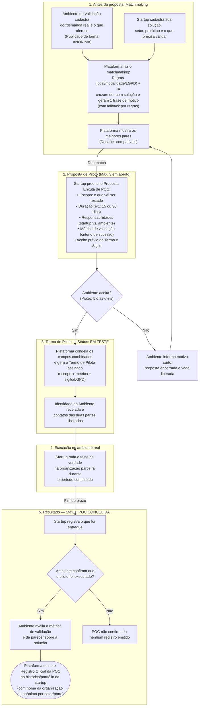
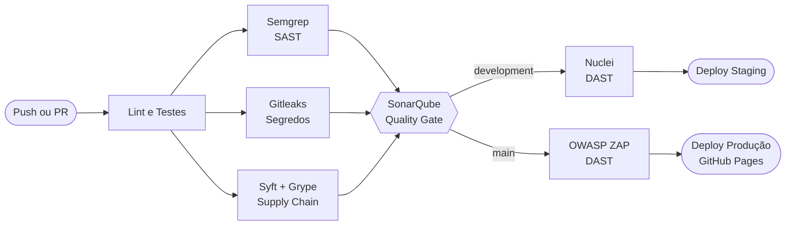

<div align="center">

# 🪽 Azreal

### Da hipótese ao teste real: matchmaking de validação e POC

Plataforma de matchmaking que conecta startups *early stage* a ambientes de validação (empresas, instituições e órgãos parceiros) com demandas operacionais reais para realizar Provas de Conceito (POCs) estruturadas e gerar evidências de tração.

Projeto da **Unidade de Extensão Fullstack** — SENAC 2026.2
Docente: **Prof. Fábio Chicout**

`Spring Boot 3` · `Angular 22 Zoneless`

[](https://github.com/HtaOliva/Azreal/actions/workflows/ci-cd.yml)
[](https://sonar.fchicout.dev/dashboard?id=azreal-backend)
[](https://sonar.fchicout.dev/dashboard?id=azreal-frontend)


### 🌐 [Ver o site no ar](https://htaoliva.github.io/Azreal/) · 🔍 [Painel no SonarQube](https://sonar.fchicout.dev)

</div>

---

## 📑 Índice

- [Sobre o projeto](#-sobre-o-projeto)
  - [Contexto e problema](#contexto-e-problema)
  - [Público-alvo](#público-alvo)
  - [Necessidades e comportamento atual](#necessidades-e-comportamento-atual)
  - [Evidências e validação](#evidências-e-validação)
  - [Direção da solução](#direção-da-solução)
  - [Próximos passos](#próximos-passos)
  - [Equipe](#equipe)
- [Visão geral técnica](#️-visão-geral-técnica)
- [Pipeline de CI/CD](#-pipeline-de-cicd)
- [Política de branches](#-política-de-branches)
- [Configuração: SonarQube e Secrets](#️-configuração-sonarqube-e-secrets)
- [Rodando localmente](#-rodando-localmente)

---

## 🧭 Sobre o projeto

O **Azreal** é uma plataforma de matchmaking de validação que conecta startups *early stage* a empresas, instituições e órgãos com demandas operacionais reais para realizar **Provas de Conceito (POCs)** estruturadas e gerar evidências verificáveis de tração.

### Contexto e problema

Startups *early stage* enfrentam um gargalo crítico na transição entre protótipo e mercado: conseguir validar a solução em um ambiente real para conquistar os primeiros clientes e comprovar tração em editais de fomento.

**O que foi observado nas entrevistas:**
- **Validação e POC como maior dor:** as duas startups *early stage* entrevistadas apontaram diretamente a **validação** — e especificamente a **Prova de Conceito (POC)** aplicada em ambiente real — como sua principal dificuldade para detectar e conquistar clientes, definindo a POC como um documento essencial que atesta a validação e serve como tracionamento para editais e programas.
- **Prospecção improvisada e fria:** sem um canal estruturado, as equipes tentam validar suas ideias por conta própria enviando mensagens frias (*direct* no Instagram, e-mails, formulários) ou abordando pessoas em eventos e grupos de WhatsApp.
- **Convergência com mentores e articuladores:** nas entrevistas complementares, o *matching comercial* foi apontado como o mais necessitado pelas startups, destacando-se que a validação funciona melhor no modelo de inovação aberta — quando a startup testa sua solução resolvendo uma **demanda real e prioritária** de um **ambiente de validação** (empresa, instituição ou secretaria de governo), em vez de tentar impor uma hipótese isolada.

**Oportunidade:** substituir a busca informal e fria por um matchmaking estruturado entre **Desafios de Validação** (dores operacionais publicadas de forma anônima por organizações parceiras) e **Soluções de Startups**, formalizando o combinado em um **Termo de Piloto** e gerando, após o teste prático, um **Registro Oficial de POC** confirmado pelo parceiro.

<details>
<summary><b>Evidências, interpretações e hipóteses</b></summary>

**Evidências explícitas (relatadas nas entrevistas e dados públicos):**

- Validação e realização da POC em ambiente real relatadas como principal dificuldade para conseguir clientes pelas startups entrevistadas (*Nook* e *Rede Leito*).
- POC descrita pelas startups como documento essencial de tracionamento para editais e programas.
- Busca atual de validação feita manualmente por redes sociais, e-mails, formulários, eventos e grupos de WhatsApp.
- Priorização, pelas startups entrevistadas, de visibilidade, conexão com o ecossistema e editais acima de investimento-anjo.
- Baixíssima conexão de empresas jovens de TI/Software do Recife (abertas entre 2022 e 2025) com contratos públicos municipais (0,24%), segundo cruzamento de dados públicos.

**Interpretações plausíveis (derivadas das fontes):**

- O principal gargalo das startups *early stage* está em destravar o primeiro teste prático (POC) sobre uma demanda real, e não na busca imediata por investidor-anjo.
- A publicação anônima de desafios com liberação progressiva de dados (após aceite do Termo de Piloto e sigilo) reduz a exposição das organizações parceiras e evita abordagens fora da plataforma.

**Hipóteses a validar:**

- Organizações locais (empresas, instituições de ensino/saúde e órgãos públicos) estão dispostas a cadastrar dores operacionais reais e ceder ambiente para testar soluções de startups *early stage* sem custo inicial de aquisição.
- Startups *early stage* preferem submeter propostas enxutas de POC a demandas reais de parceiros em vez de prospectar clientes apenas de forma fria.

</details>

### Público-alvo

| Lado | Descrição |
| --- | --- |
| **Lado A — Startups (*Usuário principal*)** | Startups *early stage* de base tecnológica e economia criativa (inicialmente em Recife/PE), sem receita recorrente relevante, que já possuem protótipo ou MVP inicial e precisam testá-lo em ambiente real para validar o produto, conquistar clientes ou comprovar tração em editais. |
| **Lado B — Ambientes de Validação (*Parceiro demandante*)** | Pequenas e médias empresas, instituições de ensino/saúde, comunidades e órgãos públicos locais que possuem dores operacionais reais e abrem espaço controlado para testar soluções inovadoras em formato de piloto. |
| **Administrador** | Equipe responsável por manter o vocabulário de setores/temas, os termos da plataforma e a moderação de contas. |

### Necessidades e comportamento atual

| Dores observadas | Necessidades | Comportamento atual |
| --- | --- | --- |
| Dificuldade para validar o produto em ambiente real e gerar a POC *(relatado)* | Canal estruturado para encontrar organizações dispostas a rodar um teste piloto *(inferida)* | Mandam mensagens frias no Instagram/e-mail, aplicam formulários e vão a eventos |
| Falta de acompanhamento estruturado sobre os próximos passos práticos *(relatado)* | Escopo, duração, responsabilidades e métrica de validação claros antes de iniciar o teste *(proposta)* | Buscam direcionamento por conta própria e tiram dúvidas pontuais com mentores |
| Dificuldade de comprovar tração para editais e primeiros clientes *(relatado)* | Registro verificável de POC confirmada por um ambiente real *(proposta)* | Tentam explicar o projeto sem histórico formalizado de validação externa |

### Evidências e validação

Síntese do status das hipóteses e evidências do projeto:

| Ponto analisado | Situação nas fontes |
| --- | --- |
| Startups *early stage* têm na validação/POC sua maior barreira para conseguir clientes | **Evidência direta** (relato convergente das startups entrevistadas) |
| A POC funciona como atestado de validação e requisito de tração para editais | **Evidência direta** (relato das startups entrevistadas) |
| Matching comercial e conexão com ambientes de validação têm alto valor no estágio inicial | **Perspectiva convergente** (empreendedor/comunidade e mentor entrevistados) |
| Empresas de TI recém-abertas no Recife têm conexão quase nula (0,24%) com compras públicas | **Evidência quantitativa** (cruzamento de bases públicas 2022–2025) |
| Organizações parceiras publicarão desafios reais e confirmarão o Registro de POC na plataforma | **Hipótese principal a validar** no MVP |

### Direção da solução e Fluxo Principal do MVP

**Proposta de valor:** para **startups *early stage***, o Azreal oferece matchmaking com demandas reais de organizações parceiras, transformando tentativas informais de prospecção em **Provas de Conceito (POCs) estruturadas e atestadas**. Para **ambientes de validação**, permite experimentar soluções tecnológicas sob medida para suas dores prioritárias, com identidade protegida até o aceite do piloto.

#### Passo a passo do MVP (7 etapas)

1. **Cadastro e Perfil de Capacidade / Ambiente (com consentimento LGPD):**
   - A **Startup** cadastra sua solução, setor/temas de atuação, estágio do protótipo e o que precisa validar em ambiente real.
   - O **Ambiente de Validação (Organização Parceira)** cadastra seu perfil e publica **Desafios de Validação** descrevendo a dor operacional, a prioridade, o ambiente disponível para teste (ex.: nº de usuários/setor), a modalidade (presencial ou remota) e a duração máxima do piloto.
2. **Publicação anônima do desafio:**
   - O desafio é exibido às startups apenas como problema — com setor, público de teste e restrições —, **sem o nome da organização**. A identidade do Ambiente de Validação só é revelada após a formalização do Termo de Piloto pelos dois lados (Passo 5).
3. **Matchmaking de Demanda ↔ Solução (Apoiado por IA + Regras de Restrição e Fallback):**
   - O sistema primeiro filtra critérios objetivos (localidade, modalidade presencial ou remota, requisitos de privacidade/LGPD).
   - Em seguida, a IA compara o texto de cada desafio com o perfil da startup, ordena os desafios do mais ao menos compatível (sem pontuação percentual) e **explica em uma frase curta o motivo de cada sugestão**.
   - *Contingência (Fallback):* caso a API externa de IA esteja indisponível, o sistema ordena automaticamente por regras objetivas (setor, temas e modalidade) e exibe uma justificativa padronizada por template.
4. **Proposta de POC (Solicitação Estruturada com Aceite Prévio):**
   - A startup visualiza os desafios recomendados e envia uma **Proposta Enxuta de POC** contendo: objetivo do teste, o que será entregue no piloto, responsabilidades sugeridas, duração e **métrica de validação** (critério de sucesso), assinando preventivamente o aceite do Termo de Piloto e Cláusula de Sigilo. O limite é de até **3 propostas simultâneas em aberto** por startup.
5. **Aceite e Termo de Piloto (`Status: EM TESTE`):**
   - O Ambiente de Validação analisa a proposta na sua fila (prazo de resposta de até 5 dias úteis).
   - **Se aceitar:** como a startup já deu o aceite prévio ao submeter a proposta, o aceite do Ambiente congela imediatamente os campos combinados e firma o **Termo de Piloto** (escopo, duração, responsabilidades de cada lado, métrica de validação e cláusula de sigilo). Só então a identidade do ambiente é revelada e os canais de contato são liberados.
   - **Se recusar:** o ambiente informa um motivo curto (ex.: fora de prioridade, prazo incompatível), a proposta é encerrada e a vaga no limite de 3 propostas da startup é liberada para uma nova submissão.
6. **Execução do piloto em ambiente real:**
   - A startup executa o teste de verdade no ambiente do parceiro, dentro do escopo e da duração definidos no Termo de Piloto, e registra a entrega ao final do prazo.
7. **Conclusão e Registro de POC (`Status: POC CONCLUÍDA`):**
   - Ao fim do piloto, o Ambiente de Validação confirma se o teste ocorreu:
     - **Se o teste ocorreu:** o parceiro avalia o resultado com base na métrica de validação definida no Termo (*Atendeu totalmente*, *Atendeu parcialmente* ou *Não atingiu a métrica*) e registra seu parecer. A plataforma emite no histórico/portfólio da startup o **Registro Oficial de POC**, que pode exibir o nome da organização ou manter formato anônimo qualificado (apenas setor e porte), conforme autorização do ambiente.
     - **Se o teste não ocorreu / foi abandonado:** o piloto é encerrado como *POC não confirmada*, sem emissão de atestado.



**Fora do escopo do MVP:**
- Matchmaking com investidores-anjo, cálculo de *valuation* ou captação financeira.
- Matchmaking centrado em mentoria contínua e registro de atas de encontros.
- Sistemas de pontuação ponderada com soma 100% ou *scorecards* numéricos.
- Assinatura jurídica avançada de contratos/NDAs complexos ou intermediação financeira.
- Cursos, trilhas de conteúdo ou certificados de capacitação.

### Próximos passos

1. Validar a hipótese principal com 2 a 3 potenciais Ambientes de Validação locais (empresas, coordenações acadêmicas ou órgãos parceiros), coletando desafios reais para o catálogo inicial.
2. Testar a submissão de Proposta Enxuta de POC com as startups entrevistadas (*Nook* e *Rede Leito*) e outras startups incubadas.
3. Ajustar as entidades do back-end e componentes do front-end da Sprint 1 para o fluxo **Desafio → Matchmaking → Proposta de POC → Termo de Piloto → Registro de POC**.
4. Validar em prova técnica a latência e o *fallback* por regras na ordenação por IA (`RF24` / `RNF10`).

### Equipe

**Grupo 2 – Azrael:** Alanna Santos, Giselly Lima (representante), Ágata Oliveira, César Silva e Arthur Cunha.

---

## 🏛️ Visão geral técnica

Scaffolding padronizado para os projetos da Unidade de Extensão Fullstack.

| Camada | Tecnologias |
| --- | --- |
| **Backend** | Java 21 LTS, Spring Boot 3.3, Spring Web, Spring Validation, Actuator, ArchUnit, Checkstyle, JaCoCo |
| **Frontend** | Angular 22 (100% Zoneless), Signals, OnPush, Vitest, ESLint, build com esbuild/Vite |
| **Qualidade** | SonarQube institucional com o padrão "Sonar way" |
| **Segurança** | Semgrep (SAST), Gitleaks (segredos), Syft + Grype (supply chain), Nuclei e OWASP ZAP (DAST) |
| **Entrega** | GitHub Actions, com deploy do frontend no GitHub Pages |

---

## 🔄 Pipeline de CI/CD

Todo push e todo pull request passam pelas mesmas etapas. Se qualquer *gate* falhar, nada é publicado.



| Etapa | Ferramenta | Bloqueia o pipeline? |
| --- | --- | :---: |
| Lint (Java e Angular) | Checkstyle, ESLint | ✅ |
| Testes e cobertura | JUnit 5, JaCoCo, Vitest | ✅ |
| SAST | Semgrep (OWASP Top 10, Java, TypeScript) | ✅ erros de severidade alta |
| Segredos vazados | Gitleaks | ✅ |
| Supply chain | Syft (SBOM SPDX) + Grype (CVEs) | ✅ vulnerabilidades críticas |
| Qualidade de código | SonarQube (backend e frontend) | ✅ |
| DAST em staging | Nuclei | ⚠️ apenas informativo |
| DAST em produção | OWASP ZAP Baseline | ⚠️ apenas informativo |

---

## 🌳 Política de branches

| Branch | Função | O que o push dispara |
| --- | --- | --- |
| `development` | Integração ativa | Todos os gates, DAST com **Nuclei** e deploy em **Staging** |
| `main` | Versão estável | Todos os gates, DAST com **OWASP ZAP** e deploy em **Produção** |
| `feature/*` · `bugfix/*` | Trabalho individual ligado a Issues | Integradas via Pull Request em `development` |

O passo a passo completo do fluxo está no [GITHUB_SETUP_GUIDE.md](GITHUB_SETUP_GUIDE.md).

---

## ⚙️ Configuração: SonarQube e Secrets

Faça isto antes de abrir o primeiro Pull Request.

<details>
<summary><b>1. Criar o projeto no SonarQube institucional</b></summary>

1. Acesse <https://sonar.fchicout.dev> com as credenciais fornecidas pelo professor.
2. Clique em **Projects → Create Project → Manually**.
3. Preencha:
   - **Project display name:** nome do projeto (ex.: `azreal-backend`).
   - **Project key:** identificador único (ex.: `azreal-backend`).
     Deve ser **idêntico** ao `<sonar.projectKey>` do `pom.xml` da raiz.
   - **Main branch name:** `main`.
4. Gere o token em **My Account → Security → Generate Tokens**:
   - **Type:** `Project Analysis Token`
   - **Project:** o projeto criado
   - **Expires in:** escolha um prazo longo, para o pipeline não quebrar de repente.
5. Copie o token na hora, pois ele só aparece uma vez.

> Cada token vale para um projeto só. O frontend usa um projeto e um token próprios.

</details>

<details>
<summary><b>2. Cadastrar os Secrets no GitHub</b></summary>

Em **Settings → Secrets and variables → Actions → New repository secret**:

| Secret | Valor | Para quê |
| --- | --- | --- |
| `SONAR_TOKEN` *(obrigatório)* | Token do projeto do backend | Autentica a análise do backend |
| `AZREAL_FRONTEND` *(obrigatório)* | Token do projeto do frontend | Autentica a análise do frontend |
| `SONAR_HOST_URL` *(opcional)* | `https://sonar.fchicout.dev` | Endereço do SonarQube |

Depois, em **Settings → Actions → General → Workflow permissions**, escolha **Read and write permissions**.

</details>

<details>
<summary><b>3. Ativar o GitHub Pages</b></summary>

Em **Settings → Pages**, deixe **Source** como **GitHub Actions**. Não use os modelos sugeridos (Jekyll ou Static HTML), porque o `ci-cd.yml` já faz a publicação.

</details>

<details>
<summary><b>4. Proteger as branches</b></summary>

Em **Settings → Branches → Add branch protection rule**, para `development` e `main`:

- ✅ Require a pull request before merging (mínimo de 1 aprovação)
- ✅ Require status checks to pass before merging:
  - `🧪 Lint & Automated Tests`
  - `🔒 SAST - Semgrep Security Audit`
  - `📦 Supply Chain - Syft (SBOM) & Grype (CVEs)`
  - `🛡️ SonarQube Quality Gate`
  - `🛡️ SonarQube Quality Gate (Frontend)`
- ✅ Require branches to be up to date before merging

</details>

---

## 💻 Rodando localmente

Valide tudo antes de abrir o Pull Request.

### Backend · Spring Boot 3 + Java 21

```bash
# Checkstyle, testes JUnit 5 e relatório JaCoCo
mvn -B checkstyle:check test jacoco:report -f backend/pom.xml

# Subir a aplicação
mvn clean spring-boot:run -f backend/pom.xml
```

| Recurso | Endereço |
| --- | --- |
| Boas-vindas | <http://localhost:8080/api/v1/hello> |
| Healthcheck | <http://localhost:8080/api/v1/health> |
| Relatório JaCoCo | `backend/target/site/jacoco/index.html` |

### Frontend · Angular 22 Zoneless

```bash
cd frontend

npm ci                  # instalação limpa
npm run lint            # ESLint
npm run test:coverage   # testes com Vitest
npm run build           # build de produção com esbuild
npm start               # servidor local
```

Aplicação web: <http://localhost:4200>

---

<div align="center">

Feito com ☕ pela **Equipe Azrael** · SENAC 2026.2

</div>
