# 09 — Planejamento de Sprints do Backend (Novembro/2026) — Azreal (POC-Match)

**Período:** 02 de Novembro a 30 de Novembro de 2026 (4 Sprints Semanais)  
**Referências Oficiais:**  
- [DOCUMENTO_OFICIAL_AZREAL_POC.md](../DOCUMENTO_OFICIAL_AZREAL_POC.md)  
- **Parecer Técnico de Auditoria & Engenharia de Software — Prof. Fábio Chicout (30/10/2026)**

---

## 1. Adequação às Normas do Parecer Técnico de Auditoria (30/10/2026)

Todas as exigências técnicas e de governança apontadas na auditoria foram incorporadas ao plano de ataque da **Sprint 1** antes de qualquer envio ao repositório remoto:

| Issue / Norma do Parecer | Diagnóstico da Auditoria | Ação Incorporada na Sprint 1 | Responsável Oficial |
| :--- | :--- | :--- | :--- |
| **Issue `#27` (`[CORE-ALIGN-01]`)** | Presença de `Mentor`, `VinculoMentoria`, `AnotacaoMentoria`, `MentorController`, `AnotacaoController` (domínio exclusivo do *DaMatch*). | **Remoção total e imediata** de todas as classes, DTOs, repositórios e testes de Mentoria já na Sprint 1, substituindo por `AmbienteValidacao`. | Ágata Oliveira / Cesar Silva |
| **Issue `#28` (`[DOCS-01]`)** | Arquivos `00` a `07` em `docs/` com 100% de placeholders do template Corbenic (`[Nome da ONG]`, `[Nome do Aluno]`). | **Saneamento integral** de todos os documentos em `docs/` com os dados reais da equipe Azreal e os requisitos `RF01`–`RF21`. | Ágata Oliveira |
| **Issue `#25` (`[GOV-01]`)** | `pom.xml` em `1.0.0-SNAPSHOT`, `package.json` em `1.0.0` e `git tag -l` vazio. | Sincronizar `pom.xml` (raiz e backend) e `frontend/package.json` para `0.1.0-alpha` e publicar tag anotada `v0.1.0-alpha`. | Arthur Cunha |
| **Issue `#26` (`[GOV-02]`)** | Repositório apenas com as 10 labels padrão do GitHub. | Parametrizar as **23 labels oficiais em 5 dimensões** (`type:`, `scope:`, `stack:`, `priority:`, `status:`). | Arthur Cunha |
| **Issue `#29` (`[DB / Flyway]`)** | Entidades JPA com `ddl-auto: update` e ausência de migrations versionadas. | Adicionar **Flyway** (`flyway-core` + `flyway-database-postgresql`) e criar migrations versionadas `V1__init_poc_match_sprint1.sql`. | Giselly Lima |
| **Issue `#37` (`[SEC-01]`)** | Autenticação mockada e necessidade de bind real no servidor `lldap.fchicout.dev` (`azrael_app` / grupo `azrael_admin` ID 12). | Ajustar `LdapSecurityConfig` e `AuthController` para mapear `azrael_admin` → `ROLE_ADMIN`, `ROLE_STARTUP` e `ROLE_AMBIENTE_VALIDACAO`. | Arthur Cunha / Cesar Silva |
| **Issue `#38` (`[QUAL-01]`)** | PR #24 gigante (49 commits, +8.241 linhas) e travado no Quality Gate do SonarQube. | Corrigir cobertura/testes, manter Quality Gate verde e adotar PRs curtos e atômicos com *Conventional Commits*. | Giselly Lima / Alanna Santos |
| **Issue `#39` (`[DOCS-02]`)** | Ausência de documentação interativa gerada pela aplicação. | Configurar **SpringDoc OpenAPI 3 + Swagger UI** (`/swagger-ui.html` e `/v3/api-docs`) no backend. | Arthur Cunha |

---

## 2. Cronograma das 4 Sprints de Backend (Novembro/2026)

```mermaid
flowchart LR
    subgraph S1["Sprint 1 (02/11 a 08/11) — Saneamento & Fundação"]
        direction TB
        S1A["Expurgo de Mentoria (#27) + SemVer 0.1.0-alpha (#25)"]
        S1B["Flyway Migrations (#29) + SpringDoc Swagger UI (#39)"]
        S1C["LLDAP (azrael_admin / azrael_app #37) + RBAC + LGPD"]
        S1D["Perfis Startup & Ambiente de Validação + Catálogos Admin"]
    end

    subgraph S2["Sprint 2 (09/11 a 15/11) — Desafios & Matchmaking"]
        direction TB
        S2A["Desafios de Validação (CRUD + Inativação + Flyway V2)"]
        S2B["Privacidade em Camadas (DTO Anônimo RNF04)"]
        S2C["Matchmaking: Pré-filtro + IA Semântica + Fallback Regras"]
    end

    subgraph S3["Sprint 3 (16/11 a 22/11) — Propostas & Termo de Piloto"]
        direction TB
        S3A["Proposta Enxuta de POC (Limite máx. 3 abertas + Flyway V3)"]
        S3B["Fila do Ambiente (5 dias úteis PE) + Recusa/Cancelamento"]
        S3C["Aceite, Congelamento e Termo de Piloto (Revela Identidade)"]
    end

    subgraph S4["Sprint 4 (23/11 a 30/11) — Execução, Registro POC & Release"]
        direction TB
        S4A["Entrega do Piloto + Confirmação do Ambiente (Flyway V4)"]
        S4B["Emissão do Registro Oficial de POC (Nominal/Anônimo)"]
        S4C["Avaliação do Match + Auditoria Imutável + Release v1.0.0"]
    end

    S1 --> S2 --> S3 --> S4
```

---

## 3. Detalhamento por Sprint

### 🏁 Sprint 1: Saneamento da Auditoria, Flyway, LLDAP, Perfis (`Startup` & `AmbienteValidacao`) e Admin
**Período:** `02/11/2026` a `08/11/2026`  
**Requisitos e Issues:** `RF01`, `RF02`, `RF03`, `RF04`, `RF07`, `RF08`, `RF09`, `RNF04`, `RNF05` + **Issues `#25`, `#27`, `#28`, `#29` (Flyway), `#37`, `#38`, `#39`**.

1. **Desacoplamento Total do Domínio de Mentoria (`Issue #27`):**
   - Remover imediatamente `Mentor`, `MentorController`, `MentorService`, `MentorRepository`, `MentorRequestDTO`, `MentorResponseDTO`, `MentorUpdateDTO`, `VinculoMentoria`, `VinculoController`, `VinculoGestaoController`, `VinculoService`, `VinculoMentoriaRepository`, `AnotacaoMentoria`, `AnotacaoController`, `AnotacaoService`, `AnotacaoMentoriaRepository`, `Recomendacao`, `RecomendacaoController`, `RecomendacaoService`, `RecomendacaoRepository` e seus respectivos testes legados.
2. **Saneamento Documental (`Issue #28`) e Governança SemVer (`Issue #25`):**
   - Preencher integralmente `docs/00-architecture-frontier.md` a `docs/07-ui-ux-walkthrough-roadmap.md` eliminando 100% dos placeholders `[Nome da ONG]` e `[Nome do Aluno]`.
   - Atualizar a `<version>` no `pom.xml`, `backend/pom.xml` e `frontend/package.json` para `0.1.0-alpha`.
3. **Infraestrutura de Banco (Flyway — `Issue #29`) e Documentação OpenAPI (`Issue #39`):**
   - Adicionar dependências do **Flyway** e **SpringDoc OpenAPI (`springdoc-openapi-starter-webmvc-ui`)** no `backend/pom.xml`.
   - Criar `V1__init_poc_match_sprint1.sql` com as tabelas `tb_usuario`, `tb_aceite_termo`, `tb_tema`, `tb_incubadora`, `tb_regra_plataforma`, `tb_startup`, `tb_startup_integrante`, `tb_startup_tema`, `tb_startup_modalidade` e `tb_ambiente_validacao`.
4. **Segurança LLDAP Institucional (`Issue #37`), RBAC (`RF04`) e LGPD (`RNF05`):**
   - Configurar bind com `lldap.fchicout.dev` (`Service Account: azrael_app`, grupo `azrael_admin` → `ROLE_ADMIN`) e perfis `ROLE_STARTUP`, `ROLE_AMBIENTE_VALIDACAO` e `ROLE_ADMIN`.
   - Evoluir `AceiteTermo` com consentimento explícito para envio de textos anônimos à IA (`RNF05`) e endpoint `DELETE /me` para exclusão/inativação da própria conta.
5. **Perfis `Startup` (`RF01`, `RF02`), `AmbienteValidacao` (`RF03`) e Catálogos Admin (`RF07`, `RF08`, `RF09`):**
   - Refatorar `Startup` e `Estagio` (`PROTOTIPO_INICIAL`, `MVP_FUNCIONAL`, `EM_TESTE`, `oQuePrecisaValidar`, `ufIbge`, `municipioIbge`, `temasIds`, `modalidadesSuportadas`).
   - Criar `AmbienteValidacao` (`POST /ambientes-validacao`, `GET /ambientes-validacao/{id}`, `PUT /ambientes-validacao/{id}`).
   - Ajustar `Tema` (`SETOR`/`TEMA`), `Incubadora` e `RegraPlataforma` (Modelo Base do Termo de Piloto e Cláusula de Sigilo).

---

### 🔍 Sprint 2: Desafios de Validação (Anonimato em Camadas) e Matchmaking (IA + Fallback)
**Período:** `09/11/2026` a `15/11/2026`  
**Requisitos:** `RF05`, `RF06`, `RF10`, `RF11`, `RNF01`, `RNF03`, `RNF04`, `RNF06`.

1. **Migration `V2__create_desafio_validacao.sql` e CRUD de Desafios (`RF05`).**
2. **Isolamento em Camadas (`RF06`, `RNF04`):** `DesafioAnonimoResponseDTO` ocultando 100% da razão social, nome fantasia, CNPJ e contatos antes do aceite do Termo de Piloto.
3. **Motor de Matchmaking (`RF10`, `RF11`, `RNF03`, `RNF06`):** pré-filtro determinístico + ordenação semântica via IA (1 frase curta de justificativa, sem porcentagem) + proteção contra *Prompt Injection* + **Fallback automático por regras e template**.

---

### 🤝 Sprint 3: Proposta Enxuta de POC, Fila (5 Dias Úteis PE) e Termo de Piloto
**Período:** `16/11/2026` a `22/11/2026`  
**Requisitos:** `RF12`, `RF13`, `RF14`, `RF15`, `RF16`, `RF17`, `RNF02`, `RNF04`, `RNF08`.

1. **Migration `V3__create_proposta_poc_termo_piloto.sql` e Submissão de Proposta Enxuta (`RF12`, `RF13`):** limite de **3 propostas pendentes** simultâneas em desafios distintos e aceite prévio do Termo de Piloto e Sigilo.
2. **Fila do Ambiente em 5 Dias Úteis de PE (`RF14`, `RF16`):** cancelamento pela startup e recusa motivada pelo ambiente (liberando vaga no limite de 3).
3. **Aceite e Termo de Piloto Congelado (`RF15`):** geração de `TermoPiloto` (`Status: EM_TESTE`) e revelação da identidade e contatos do Ambiente de Validação.

---

### 🏆 Sprint 4: Execução, Registro Oficial de POC, Qualidade do Match e Release `v1.0.0`
**Período:** `23/11/2026` a `30/11/2026` *(Marco Final M6 em 27/11/2026)*  
**Requisitos:** `RF18`, `RF19`, `RF20`, `RF21`, `RNF01`, `RNF02`, `RNF08`.

1. **Migration `V4__create_registro_poc_auditoria.sql`, Entrega (`RF18`) e Confirmação pelo Ambiente (`RF19`).**
2. **Emissão do Registro Oficial de POC (`RF20`):** portfólio verificável com exibição nominal ou anônima qualificada (setor e porte).
3. **Avaliação do Matchmaking (`RF21`), Trilha Imutável de Auditoria (`RNF08`) e Tag SemVer `v1.0.0`.**
