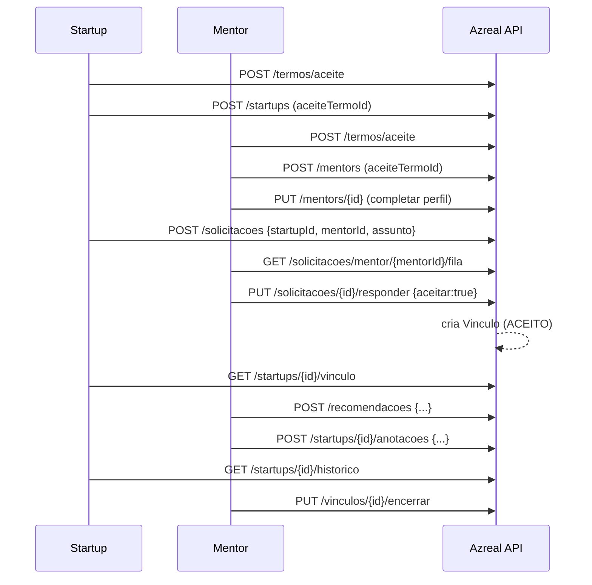

# Mapa de Endpoints — Azreal API

Base URL: `http://localhost:8080` (local) / `https://api.azreal.example.com` (prod).
Autenticação: JWT Bearer (retornado por `POST /auth/login`). Perfis: `STARTUP`, `MENTOR`, `ADMIN`.
Endpoints públicos (sem token): `/auth/login`, `/api/v1/health`, `/api/v1/hello`, `/startups` (POST), `/mentors` (POST), `/termos/aceite`, `/incubadoras` (GET ativas), `/temas` (GET ativos), `/regras` (GET ativa). Os demais exigem token; vários têm restrição adicional por perfil via `@PreAuthorize`.

## 1. Índice de endpoints

### Auth & perfil
| Método | Path | Perfil | Descrição |
|---|---|---|---|
| POST | `/auth/login` | público | Login (LLDAP), retorna JWT + roles |
| GET | `/me` | autenticado | Perfil do usuário autenticado |

### Health / Hello
| Método | Path | Perfil | Descrição |
|---|---|---|---|
| GET | `/api/v1/health` | público | Health check |
| GET | `/api/v1/hello?name=` | público | Saudação |

### Startups
| Método | Path | Perfil | Descrição |
|---|---|---|---|
| POST | `/startups` | público | Cadastro de startup (exige `aceiteTermoId`) |
| GET | `/startups` | público* | Lista startups |
| GET | `/startups/{id}` | público* | Busca startup por id |
| PUT | `/startups/{id}` | STARTUP/ADMIN | Atualiza startup (dono ou admin) |

### Mentores
| Método | Path | Perfil | Descrição |
|---|---|---|---|
| POST | `/mentors` | público | Cadastro de mentor (exige `aceiteTermoId`) |
| GET | `/mentors` | público* | Lista mentores |
| GET | `/mentors/{id}` | público* | Busca mentor por id |
| PUT | `/mentors/{id}` | MENTOR/ADMIN | Atualiza mentor (dono ou admin) |

### Termos
| Método | Path | Perfil | Descrição |
|---|---|---|---|
| POST | `/termos/aceite` | público | Registra aceite dos termos (gera `aceiteTermoId`) |

### Solicitações de mentoria
| Método | Path | Perfil | Descrição |
|---|---|---|---|
| POST | `/solicitacoes` | STARTUP/ADMIN | Cria pedido de mentoria (limite 2 abertos) |
| PUT | `/solicitacoes/{id}/responder` | MENTOR/ADMIN | Aceita/recusa pedido; se aceitar cria vínculo |
| GET | `/solicitacoes/mentor/{mentorId}/fila` | MENTOR/ADMIN | Fila de pedidos pendentes do mentor |

### Vínculos
| Método | Path | Perfil | Descrição |
|---|---|---|---|
| GET | `/startups/{id}/vinculo` | STARTUP/ADMIN | Vínculo ativo da startup (+ contato do mentor) |
| PUT | `/vinculos/{id}/encerrar` | MENTOR/ADMIN | Encerra vínculo |

### Recomendações / Anotações / Histórico (subrecursos de startup)
| Método | Path | Perfil | Descrição |
|---|---|---|---|
| POST | `/recomendacoes` | MENTOR/ADMIN | Recomendação de apoio (exige vínculo ativo) |
| POST | `/startups/{id}/anotacoes` | MENTOR/ADMIN | Anotação de mentoria (exige vínculo ativo) |
| GET | `/startups/{id}/historico` | STARTUP/MENTOR/ADMIN | Histórico: solicitações + recomendações + anotações |

### Regras da plataforma (admin)
| Método | Path | Perfil | Descrição |
|---|---|---|---|
| GET | `/regras` | público* | Regra ativa |
| GET | `/regras/todos` | ADMIN | Lista todas |
| POST | `/regras` | ADMIN | Cria regra |
| PUT | `/regras/{id}` | ADMIN | Atualiza regra |
| PUT | `/regras/{id}/ativo?ativo=` | ADMIN | Ativa/desativa regra |

### Temas (admin)
| Método | Path | Perfil | Descrição |
|---|---|---|---|
| GET | `/temas` | público* | Temas ativos |
| GET | `/temas/todos` | ADMIN | Lista todos |
| POST | `/temas` | ADMIN | Cria tema |
| PUT | `/temas/{id}` | ADMIN | Atualiza tema |
| PUT | `/temas/{id}/ativo?ativo=` | ADMIN | Ativa/desativa tema |

### Incubadoras (admin)
| Método | Path | Perfil | Descrição |
|---|---|---|---|
| GET | `/incubadoras` | público* | Incubadoras ativas |
| GET | `/incubadoras/todos` | ADMIN | Lista todas |
| POST | `/incubadoras` | ADMIN | Cria incubadora |
| PUT | `/incubadoras/{id}` | ADMIN | Atualiza incubadora |
| PUT | `/incubadoras/{id}/ativo?ativo=` | ADMIN | Ativa/desativa incubadora |

### Usuários (admin)
| Método | Path | Perfil | Descrição |
|---|---|---|---|
| GET | `/usuarios` | ADMIN | Lista usuários |
| GET | `/usuarios/{id}` | ADMIN | Busca usuário |
| POST | `/usuarios` | ADMIN | Cria usuário |
| PUT | `/usuarios/{id}` | ADMIN | Atualiza usuário |
| PUT | `/usuarios/{id}/ativo` | ADMIN | Ativa/desativa conta |
| DELETE | `/usuarios/{id}` | ADMIN | Remove usuário |

\* filtrado por segurança de método onde aplicável; leitura pública permitida no filtro.

## 2. Como os endpoints se conectam (fluxos)

### 2.1 Cadastro de Startup
```
POST /termos/aceite  --> aceiteTermoId
POST /startups (aceiteTermoId) --> startupId
  -> (opcional) GET /incubadoras, GET /temas (dados de referência)
  -> PUT /startups/{id} (atualização pelo próprio startup/admin)
```

### 2.2 Cadastro de Mentor
```
POST /termos/aceite --> aceiteTermoId
POST /mentors (aceiteTermoId) --> mentorId
  -> PUT /mentors/{id} (completar perfil; perfilCompleto necessário para responder pedidos)
```

### 2.3 Fluxo de mentoria (principal)
```
STARTUP: POST /solicitacoes {startupId, mentorId, assunto}
          --> Solicitacao (PENDENTE, expira em 5 dias úteis)
MENTOR:  GET  /solicitacoes/mentor/{mentorId}/fila  (exige perfil completo)
MENTOR:  PUT  /solicitacoes/{id}/responder {aceitar:true}
          --> se aceito: status ACEITO + VinculoService.criar(startup, mentor) --> vinculoId
STARTUP: GET  /startups/{id}/vinculo  --> dados do vínculo + contato do mentor
MENTOR:  POST /recomendacoes {startupId, mentorId, tipoApoio, observacao}  (exige vínculo ativo)
MENTOR:  POST /startups/{id}/anotacoes {mentorId, conteudo}  (exige vínculo ativo)
TODOS:   GET  /startups/{id}/historico  --> solicitações + recomendações + anotações
MENTOR/ADMIN: PUT /vinculos/{id}/encerrar  --> status ENCERRADO
```

### 2.4 Incubadoras — conexão com Startups
- Incubadoras são entidades de referência gerenciadas por ADMIN (`/incubadoras` CRUD + ativo).
- Leitura pública: `GET /incubadoras` retorna apenas ativas (usado no cadastro/atualização de startup).
- Startup referencia incubadora via campos `ligadaIncubadora` (boolean) e `incubadoraLigada` (id) em `POST/PUT /startups`.
- Não há vínculo automático: a associação é apenas informativa no perfil da startup; não gera permissões nem vínculo de mentoria.

### 2.5 Administração de referência
```
ADMIN: CRUD /usuarios, /temas, /incubadoras, /regras
       GET /regras (público lê a ativa), GET /temas, GET /incubadoras (ativos)
```

## 3. Dependências entre serviços (backend)

- `StartupService` / `MentorService` dependem de `AceiteTermoService` (validam `aceiteTermoId`).
- `SolicitacaoService` depende de `StartupService`, `MentorService`, `VinculoService`.
  - `responder(aceitar=true)` → `VinculoService.criar`.
- `VinculoService` depende de `MentorService` (contato).
- `RecomendacaoService` e `AnotacaoService` dependem de `VinculoService` (exigem vínculo ativo).
- `HistoricoService` agrega `SolicitacaoService`, `RecomendacaoService`, `AnotacaoService`, `StartupService`, `MentorService`, `VinculoService`.
- `MentorService` exige perfil completo (`exigirPerfilCompleto`) para responder pedidos e listar fila.

## 4. Diagrama de conexões (Mermaid)

```mermaid
flowchart LR
  subgraph Publico
    T[POST /termos/aceite]
    S0[POST /startups]
    M0[POST /mentors]
  end

  subgraph Auth
    L[POST /auth/login]
    ME[GET /me]
  end

  subgraph Startup
    S1[GET /startups]
    S2[GET /startups/{id}]
    S3[PUT /startups/{id}]
    SV[GET /startups/{id}/vinculo]
    SA[POST /startups/{id}/anotacoes]
    SH[GET /startups/{id}/historico]
  end

  subgraph Mentor
    M1[GET /mentors]
    M2[GET /mentors/{id}]
    M3[PUT /mentors/{id}]
  end

  subgraph Solicitacao
    SOL[POST /solicitacoes]
    RES[PUT /solicitacoes/{id}/responder]
    FILA[GET /solicitacoes/mentor/{id}/fila]
  end

  subgraph Vinculo
    ENC[PUT /vinculos/{id}/encerrar]
  end

  subgraph Recomendacao
    REC[POST /recomendacoes]
  end

  subgraph AdminRef[Referencia admin]
    USR[/usuarios CRUD/]
    TEM[/temas CRUD/]
    INC[/incubadoras CRUD/]
    REG[/regras CRUD/]
  end

  subgraph PublicRef[Dados publicos de referencia]
    INC_PUB[GET /incubadoras (ativas)]
    TEM_PUB[GET /temas (ativos)]
    REG_PUB[GET /regras (ativa)]
  end

  subgraph Proposto[Matchmaking incubadora (proposto)]
    MATCH[GET /incubadoras/{id}/match?startupId=]
    REC_ENT[POST /incubadoras/{id}/recomendacoes-entrada]
    COMP[GET /startups/{id}/incubadoras-compativeis]
  end

  T -->|aceiteTermoId| S0
  T -->|aceiteTermoId| M0

  S0 -->|startupId| SOL
  M0 -->|mentorId| SOL

  SOL -->|solicitacao pendente| FILA
  FILA --> RES
  RES -->|aceitar=true| VINCULO_CRIAR[VinculoService.criar]
  VINCULO_CRIAR --> SV
  VINCULO_CRIAR --> ENC

  SV --> SA
  SV --> REC
  SA --> SH
  REC --> SH
  SOL --> SH

  M3 -->|perfilCompleto| FILA
  M3 -->|perfilCompleto| RES

  AdminRef -.->|dados de referencia| S0
  AdminRef -.->|dados de referencia| M0
  INC_PUB -->|incubadoraLigada| S0
  TEM_PUB -->|temas| M0
  REG_PUB -->|regras| S0

  INC_PUB -.->|escolha de incubadora| MATCH
  S0 -.->|startupId| MATCH
  MATCH -.->|gaps de entrada| REC_ENT
  MATCH -.->|incubadoras compativeis| COMP
  REC_ENT -.->|tipo apoio: preparacao| REC
  REC_ENT -.->|gaps registrados| SA
```

### 2.4 Sequência — Fluxo de mentoria


## 4.5 Matchmaking para processos de incubadora (proposta — não implementado)

Ideia: além de vincular startup↔mentor, o sistema pode recomendar **o que a startup precisa fazer para entrar em uma incubadora** (matchmaking de processos de incubação), com base em critérios de entrada da incubadora (`criteriosEntrada`), estágio da startup (`estagioAtual`) e temas/áreas.

Endpoints sugeridos (a implementar):
| Método | Path | Perfil | Descrição |
|---|---|---|---|
| GET | `/incubadoras/{id}/match?startupId=` | STARTUP/ADMIN | Avalia aderência da startup aos critérios da incubadora |
| POST | `/incubadoras/{id}/recomendacoes-entrada` | MENTOR/ADMIN | Registra recomendações do que falta para a startup entrar |
| GET | `/startups/{id}/incubadoras-compativeis` | STARTUP/MENTOR/ADMIN | Lista incubadoras compatíveis com a startup |

Conexões propostas:
- `GET /incubadoras` (ativas) → startup escolhe incubadora de interesse.
- `GET /incubadoras/{id}/match?startupId=` → compara `criteriosEntrada` da incubadora com `estagioAtual`, `areaAtuacao`, `integrantes` da startup.
- Resultado alimenta `POST /recomendacoes` (tipo de apoio = "preparação para incubação") e anotações de mentoria.
- Mentores podem registrar gaps via `POST /startups/{id}/anotacoes`.

Estado atual: não há endpoint nem serviço de matchmaking; apenas associação informativa (`ligadaIncubadora`/`incubadoraLigada`).

## 5. Discrepâncias OpenAPI vs implementação:


- OpenAPI define `/mentors/{id}/fila`, mas a implementação expõe `/solicitacoes/mentor/{mentorId}/fila`.
- OpenAPI define `/startups/{id}/apoios-buscados`, `/startups/{id}/certificados` e `/cursos` (+ `/cursos/{id}/ativo`), **não implementados** no backend atual.
- OpenAPI define `/usuarios/{id}/ativo` como PUT com body; implementado. OK.
- Filtro de segurança permite `/usuarios/**` inteiro no filtro HTTP, mas `@PreAuthorize("hasRole('ADMIN')")` na classe garante restrição real.

## 6. Frontend (Angular) — consumo atual

Serviços frontend existentes consomem apenas:
- `HealthService` → `GET /api/v1/health`
- `HelloService` → `GET /api/v1/hello`
- `UsuarioService` → `GET /usuarios`, `POST /usuarios`
- `AuthService` (apenas storage de token; login não chamado via serviço dedicado ainda)

O restante dos endpoints ainda não possui serviço frontend correspondente.
