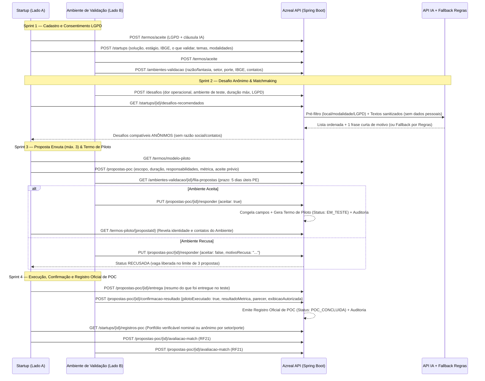

# Mapa de Endpoints — Azreal API (POC-Match)

**Base URL:** `http://localhost:8080` (local) / `https://api.azreal.example.com` (prod).  
**Autenticação:** JWT Bearer (retornado por `POST /auth/login`).  
**Perfis (RBAC — `RF04`):** `STARTUP`, `AMBIENTE_VALIDACAO`, `ADMIN` (contas `ADMIN` são criadas de forma privada pela equipe).  
**Endpoints Públicos (sem token):** `/auth/login`, `/api/v1/health`, `/api/v1/hello`, `POST /termos/aceite`, `GET /termos/modelo-piloto`, `POST /startups`, `POST /ambientes-validacao`, `GET /temas` (ativos), `GET /incubadoras` (ativas). Os demais exigem token JWT e controle estrito por perfil via `@PreAuthorize`.

---

## 1. Índice de Endpoints por Módulo e Sprint

### 🏁 Sprint 1: Auth, LGPD, Perfis (`Startup` & `AmbienteValidacao`) e Administração Base

#### Auth & Conta (`RF04`, `RF07`, `RNF05`)
| Método | Path | Perfil | Requisito | Descrição |
| :--- | :--- | :--- | :--- | :--- |
| `POST` | `/auth/login` | Público | `RF04` | Login (LLDAP / local), retorna JWT + roles (`STARTUP`, `AMBIENTE_VALIDACAO`, `ADMIN`) |
| `GET` | `/me` | Autenticado | `RF04` | Perfil do usuário autenticado |
| `DELETE` | `/me` | Autenticado | `RNF05` | Exclusão / anonimização da própria conta (direito do titular LGPD) |
| `GET` | `/api/v1/health` | Público | — | Health check da aplicação |

#### Termos LGPD e Modelo do Termo de Piloto (`RF01`, `RF03`, `RF09`, `RNF05`)
| Método | Path | Perfil | Requisito | Descrição |
| :--- | :--- | :--- | :--- | :--- |
| `POST` | `/termos/aceite` | Público | `RF01`, `RF03`, `RNF05` | Registra consentimento LGPD (com cláusula de envio de textos descritivos sem dados pessoais à IA) e retorna `aceiteTermoId` |
| `GET` | `/termos/modelo-piloto` | Público / Autenticado | `RF09`, `RF12` | Retorna o modelo base ativo do **Termo de Piloto e Cláusula de Sigilo** |
| `GET` | `/termos/modelo-piloto/todos` | `ADMIN` | `RF09` | Lista histórico de modelos de Termo de Piloto |
| `POST` | `/termos/modelo-piloto` | `ADMIN` | `RF09` | Cria nova versão do modelo base do Termo de Piloto e Cláusula de Sigilo |
| `PUT` | `/termos/modelo-piloto/{id}` | `ADMIN` | `RF09` | Atualiza versão do modelo base do Termo de Piloto |
| `PUT` | `/termos/modelo-piloto/{id}/ativo` | `ADMIN` | `RF09` | Define versão ativa do modelo base do Termo de Piloto |

#### Startups — Lado A (`RF01`, `RF02`)
| Método | Path | Perfil | Requisito | Descrição |
| :--- | :--- | :--- | :--- | :--- |
| `POST` | `/startups` | Público | `RF01`, `RF02` | Cadastro de startup (nome, solução, setor, fundação, estágio do protótipo, integrantes, UF/município IBGE, o que precisa validar, temas `RF08`, modalidades suportadas e `aceiteTermoId`) |
| `GET` | `/startups/{id}` | Autenticado | `RF01` | Busca perfil da startup por ID |
| `PUT` | `/startups/{id}` | `STARTUP` / `ADMIN` | `RF01`, `RF02` | Atualiza perfil, temas e modalidades da startup (própria startup ou admin) |

#### Ambientes de Validação — Lado B (`RF03`, `RNF04`)
| Método | Path | Perfil | Requisito | Descrição |
| :--- | :--- | :--- | :--- | :--- |
| `POST` | `/ambientes-validacao` | Público | `RF03` | Cadastro organizacional (razão social/nome fantasia, setor, porte, UF/município IBGE, e-mail obrigatório, telefone/LinkedIn opcionais e `aceiteTermoId`) |
| `GET` | `/ambientes-validacao/{id}` | `AMBIENTE_VALIDACAO` / `ADMIN` | `RF03`, `RNF04` | Consulta perfil completo do ambiente (restrito ao próprio dono ou admin; startups **não** acessam este endpoint diretamente para preservar o anonimato) |
| `PUT` | `/ambientes-validacao/{id}` | `AMBIENTE_VALIDACAO` / `ADMIN` | `RF03` | Atualiza dados organizacionais e canais de contato |

#### Administração: Vocabulário, Incubadoras e Contas (`RF07`, `RF08`)
| Método | Path | Perfil | Requisito | Descrição |
| :--- | :--- | :--- | :--- | :--- |
| `GET` | `/temas` | Público | `RF02`, `RF05`, `RF08` | Lista temas e setores ativos do vocabulário padronizado |
| `GET` | `/temas/todos` | `ADMIN` | `RF08` | Lista todos os temas/setores (ativos e inativos) |
| `POST` | `/temas` | `ADMIN` | `RF08` | Cria tema ou setor no vocabulário padronizado |
| `PUT` | `/temas/{id}` | `ADMIN` | `RF08` | Atualiza tema ou setor |
| `PUT` | `/temas/{id}/ativo` | `ADMIN` | `RF08` | Ativa ou inativa tema/setor |
| `GET` | `/incubadoras` | Público | `RF07` | Lista catálogo consultivo de incubadoras/programas ativos (com link externo) |
| `GET` | `/incubadoras/todos` | `ADMIN` | `RF07` | Lista todas as incubadoras do catálogo |
| `POST` | `/incubadoras` | `ADMIN` | `RF07` | Cadastra incubadora/programa no catálogo consultivo |
| `PUT` | `/incubadoras/{id}` | `ADMIN` | `RF07` | Atualiza incubadora/programa |
| `PUT` | `/incubadoras/{id}/ativo` | `ADMIN` | `RF07` | Ativa ou inativa incubadora/programa |
| `GET` | `/usuarios` | `ADMIN` | `RF07` | Lista contas de usuários |
| `PUT` | `/usuarios/{id}/ativo` | `ADMIN` | `RF07` | Ativa ou desativa conta de usuário |

---

### 🔍 Sprint 2: Desafios de Validação (Anonimato em Camadas) e Matchmaking (IA + Fallback)

#### Desafios de Validação (`RF05`, `RF06`, `RNF01`, `RNF04`)
| Método | Path | Perfil | Requisito | Descrição |
| :--- | :--- | :--- | :--- | :--- |
| `POST` | `/desafios` | `AMBIENTE_VALIDACAO` / `ADMIN` | `RF05` | Publica Desafio de Validação (título, dor operacional, prioridade, setor/temas, ambiente disponível, modalidade, duração máxima do piloto e restrições LGPD) |
| `PUT` | `/desafios/{id}` | `AMBIENTE_VALIDACAO` / `ADMIN` | `RF05` | Edita desafio publicado pelo próprio ambiente |
| `PUT` | `/desafios/{id}/ativo` | `AMBIENTE_VALIDACAO` / `ADMIN` | `RF05` | Ativa ou inativa desafio |
| `GET` | `/desafios/meus` | `AMBIENTE_VALIDACAO` / `ADMIN` | `RF05` | Lista desafios do próprio Ambiente de Validação |
| `GET` | `/desafios` | `STARTUP` / `ADMIN` | `RF06`, `RNF01`, `RNF04` | Lista desafios ativos em **formato estritamente anônimo** (`DesafioAnonimoResponseDTO`: problema, setor, porte da organização, localidade, modalidade, ambiente de teste, duração máxima e restrições, **sem razão social, CNPJ ou contatos**) |
| `GET` | `/desafios/{id}` | `STARTUP` / `ADMIN` | `RF06`, `RNF04` | Detalhe anônimo de um desafio ativo |

#### Matchmaking Demanda ↔ Solução (`RF10`, `RF11`, `RNF03`, `RNF06`)
| Método | Path | Perfil | Requisito | Descrição |
| :--- | :--- | :--- | :--- | :--- |
| `GET` | `/startups/{id}/desafios-recomendados` | `STARTUP` / `ADMIN` | `RF10`, `RF11`, `RNF03`, `RNF06` | Filtra desafios ativos por critérios objetivos (localidade, modalidade, restrições LGPD) e ordena do mais ao menos compatível via IA com **1 frase curta de motivo** (sem pontuação %). Em caso de falha/timeout da IA, retorna **fallback automático por regras** com justificativa por template |

---

### 🤝 Sprint 3: Proposta Enxuta de POC, Fila (5 Dias Úteis PE) e Termo de Piloto

#### Propostas de POC e Fila (`RF12`, `RF13`, `RF14`, `RF15`, `RF16`, `RF17`, `RNF02`, `RNF08`)
| Método | Path | Perfil | Requisito | Descrição |
| :--- | :--- | :--- | :--- | :--- |
| `POST` | `/propostas-poc` | `STARTUP` / `ADMIN` | `RF12`, `RF13`, `RNF02` | Submete Proposta Enxuta de POC (objetivo/escopo, entregas, responsabilidades, duração sugerida, métrica de validação e aceite prévio do Termo de Piloto e Sigilo). Limite de **3 propostas `PENDENTE`** simultâneas para desafios diferentes |
| `GET` | `/startups/{id}/propostas-poc` | `STARTUP` / `ADMIN` | `RF17` | Lista propostas e pilotos da startup (`PENDENTE`, `EM_TESTE`, `RECUSADA`, `CANCELADA`, `POC_CONCLUIDA`, `POC_NAO_CONFIRMADA`) |
| `PUT` | `/propostas-poc/{id}/cancelar` | `STARTUP` / `ADMIN` | `RF13`, `RF14` | Cancela proposta ainda `PENDENTE` antes do aceite, liberando vaga no limite de 3 |
| `GET` | `/ambientes-validacao/{id}/fila-propostas` | `AMBIENTE_VALIDACAO` / `ADMIN` | `RF14`, `RNF01` | Lista fila de propostas pendentes para os desafios do ambiente (com prazo de 5 dias úteis pelo calendário de PE) |
| `PUT` | `/propostas-poc/{id}/responder` | `AMBIENTE_VALIDACAO` / `ADMIN` | `RF15`, `RF16`, `RNF02`, `RNF08` | **Aceita** (`aceitar=true`: congela campos combinados, gera `TermoPiloto` assinado com `Status: EM_TESTE` e revela identidade/contatos) ou **Recusa** (`aceitar=false` com `motivoRecusa`: encerra proposta como `RECUSADA` e libera vaga da startup) |
| `GET` | `/termos-piloto/{propostaId}` | `STARTUP` / `AMBIENTE_VALIDACAO` / `ADMIN` | `RF15`, `RNF04` | Consulta o **Termo de Piloto** congelado e assinado pelas duas partes, incluindo a **identidade revelada do Ambiente de Validação e os canais de contato mútuos** (acessível somente após o aceite) |

---

### 🏆 Sprint 4: Execução, Confirmação, Registro Oficial de POC e Qualidade do Match

#### Entrega, Resultado, Registro Oficial de POC e Avaliação (`RF18`, `RF19`, `RF20`, `RF21`, `RNF08`)
| Método | Path | Perfil | Requisito | Descrição |
| :--- | :--- | :--- | :--- | :--- |
| `POST` | `/propostas-poc/{id}/entrega` | `STARTUP` / `ADMIN` | `RF18`, `RNF08` | Startup registra o resumo do que foi entregue ao final do piloto (`EM_TESTE`), notificando o Ambiente |
| `POST` | `/propostas-poc/{id}/confirmacao-resultado` | `AMBIENTE_VALIDACAO` / `ADMIN` | `RF19`, `RF20`, `RNF02`, `RNF08` | Ambiente confirma se o piloto ocorreu. Se **sim**, avalia a métrica (`ATENDEU_TOTALMENTE`, `ATENDEU_PARCIALMENTE`, `NAO_ATINGIU_METRICA`), registra parecer, define exibição (`NOMINAL_ORGANIZACAO` ou `ANONIMA_QUALIFICADA_SETOR_PORTE`) e emite o **Registro Oficial de POC** (`POC_CONCLUIDA`). Se **não**, encerra como `POC_NAO_CONFIRMADA` |
| `GET` | `/startups/{id}/registros-poc` | Público / Autenticado | `RF20`, `RNF01` | Portfólio/histórico verificável de **Registros Oficiais de POC** da startup (exibindo nome da organização ou apenas setor/porte conforme autorização do ambiente) |
| `GET` | `/registros-poc/{id}` | Público / Autenticado | `RF20` | Consulta um Registro Oficial de POC específico pelo seu identificador verificável |
| `POST` | `/propostas-poc/{id}/avaliacao-match` | `STARTUP` / `AMBIENTE_VALIDACAO` | `RF21` | Avaliação pós-piloto da qualidade do matchmaking (comparando eficácia da ordenação por IA vs. regras) |
| `GET` | `/propostas-poc/{id}/auditoria` | `ADMIN` | `RNF08` | Trilha imutável de auditoria das transições de status, assinaturas e emissão do registro |

---

## 2. Diagrama de Fluxo de Endpoints (Mermaid)

